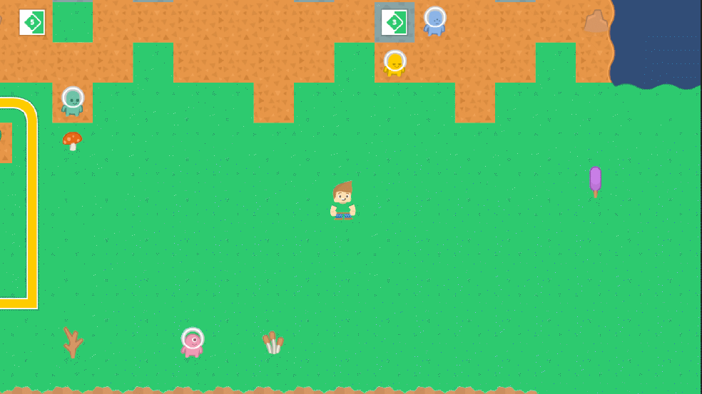

# Introducción a Unity 2D - Físicas y Tilemaps
## Actividades a realizar
> Partiendo de la escena implementada para la tarea de Sprites  construiremos un mapa de juego, que delimitará la zona en la que tendrá lugar la acción. Utiliza los recursos en el paquete generado para la práctica. Debes crear una paleta con los Tiles que consideres. Ajusta el tamaño de los Tiles al tamaño de celda del grid y subdivide aquellos Tiles que ocupen un grupo de celdas. Generar un mapa convencional que represente el entorno y límites de juego.

Primero, se ha importado el tilesheet ofrecido en el campus, aplicando las opciones correspondientes para evitar la compresión de las imágenes.

Tras esto, se ha observado que el slice automático no separa bien los tiles.


Por lo que, se ha optado por la opción de dividir por número de píxeles. En este caso, coincide que son tiles de 64x64 píxeles. El PPU también se ha configurado a 64 para que cada tile ocupe una unidad del mundo.


Para generar el mapa, me he centrado en los elementos que podrían formar un fondo simple: el suelo con hierba, piedras, tierra, etc. Estos sprites los he colocado en la paleta para convertirlos a tiles y de esta manera quedan separados de otros tiles que podrían tener otra funcionalidad.


Con las herramientas de pintura de tiles en el mundo, se ha creado un tilemap Background para dibujar el mapa y se ha generado el contorno donde se moverá el jugador. Junto con el tilemap, se ha creado automáticamente un Grid.


> Crea dos Tilemaps adicionales de obstáculos. Uno puede representar elementos decorativos y otro obstáculos.
Agrega a la capa de obstáculos la configuración necesaria para que el Tilemap se construya de forma independiente y el obstáculo actúe como tal. Esto puede dar problemas por diferentes causas:
Velocidad del renderizado muy alta: Activa detección de colisiones continua
Orden de las capas
Las capas permiten colisiones entre sí.
Tamaño y forma de los colliders. Se puede corregir editando el Sprite para adaptar la forma al objeto y aplicar Custom Physics Shape
Si has modificado la escala puede afectar a la detección de colisiones.
Agrega una capa de objetos recolectables que hagan sumar puntos al jugador, y otra de objetos que hacen daño que le resten puntos.

Para hacer esto, se han creado las diferentes capas de ordenación y se han configurado en los correspondientes tilemaps:


Después, se crearon las diferentes paletas, como la de decoración, por ejemplo:


Incluyendo la capa de decoración y la capa de obstáculos, el mapa queda de la siguiente manera:


Para generar las colisiones, a las capas de obstáculos y decoración se les ha añadido un Tilemap Collider 2D. Este collider permite generar un collider para cada uno de los tiles. Como en mapas grandes esto puede suponer un problema de eficiencia, se usa un Composite Collider para combinar todos estos colliders de cada tile.

Por último, dos capas más se han generado para los coleccionables y los elementos que producen daño. En este caso, los cuadrados con números se han usado como coleccionables y los alienígenas como daño. El mapa ha quedado de la siguiente manera:


> El último bloque de tareas con el que trabajaremos será implementar algunas mecánicas útiles:
Control del personaje 2D: En cada actualización, mediante el método Update(){ } avanzaremos el espacio que nos permite una velocidad speed, en el tiempo transcurrido. El intervalo de tiempo entre frames lo controla Time.deltaTime. Utiliza los ejes para dirigir la orientación del movimiento.
Control del personaje 2D con rotación y avance hacia adelante: En cada actualización, mediante el método Update(){ } avanzaremos siempre hacia adelante el espacio que nos permite una velocidad speed, en el tiempo transcurrido. El eje X se usa para rotar y orientarnos hacia donde queremos caminar. El eje Y se usa para avanzar una vez que estamos orientados.

El movimiento en ambos ejes es similar al de los ejercicios en 3D. El `Update()` se vería tal que así:
```cs
void Update()
{

    direction = moveAction.action.ReadValue<Vector2>();
    transform.Translate(direction.normalized * speed * Time.deltaTime);
    
    if (direction.x > 0)
    {
        spriteRenderer.flipX = false;
    } 
    else if (direction.x < 0)
    {
        spriteRenderer.flipX = true;
    }
    
}
```

Con la particularidad de hacer el flip del sprite dependiendo de si mira hacia un lado o hacia otro.


Para el caso de rotar y avanzar, el `Update()` es el siguiente:
```cs
void Update()
{
    rotateDirection = rotateAction.action.ReadValue<float>();
    transform.Rotate(0, 0, rotateDirection * rotationSpeed * Time.deltaTime);
    
    moveDirection = new Vector2(moveAction.action.ReadValue<float>(), 0);
    transform.Translate(moveDirection * moveSpeed * Time.deltaTime, Space.Self);

    if (moveDirection.x > 0)
    {
        spriteRenderer.flipX = false;
    }
    else if (moveDirection.x < 0)
    {
        spriteRenderer.flipX = true;
    }

}
```
En este segundo caso, generamos un vector con movimiento únicamente en la X local del jugador. Se podría realizar algo similar utilizando transform.right porque el eje derecho del objeto en 3D coincide con el avance del objeto en 2D. Utilizando `Space.Self`, nos aseguramos de que la X sea local y no global. En este segundo caso, lo que ocurriría sería que en lugar de ir hacia delante, iría en el eje X del mundo continuamente, perdiendo la coherencia con la rotación.

